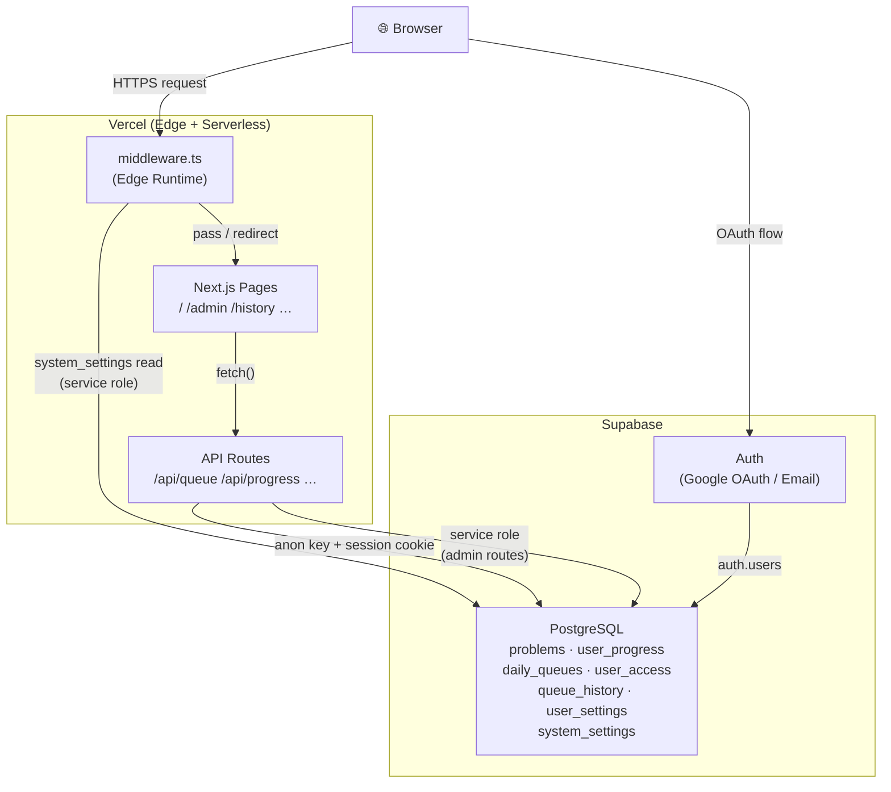
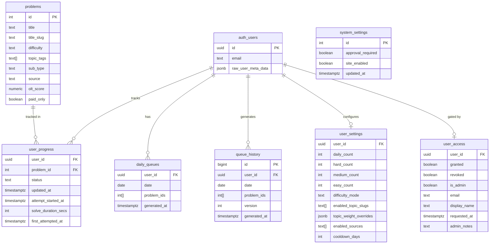
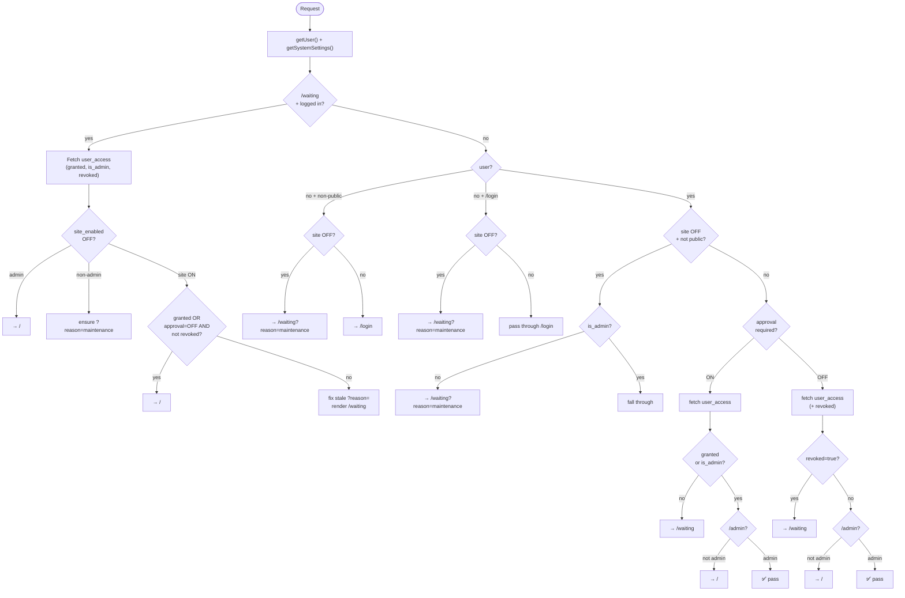
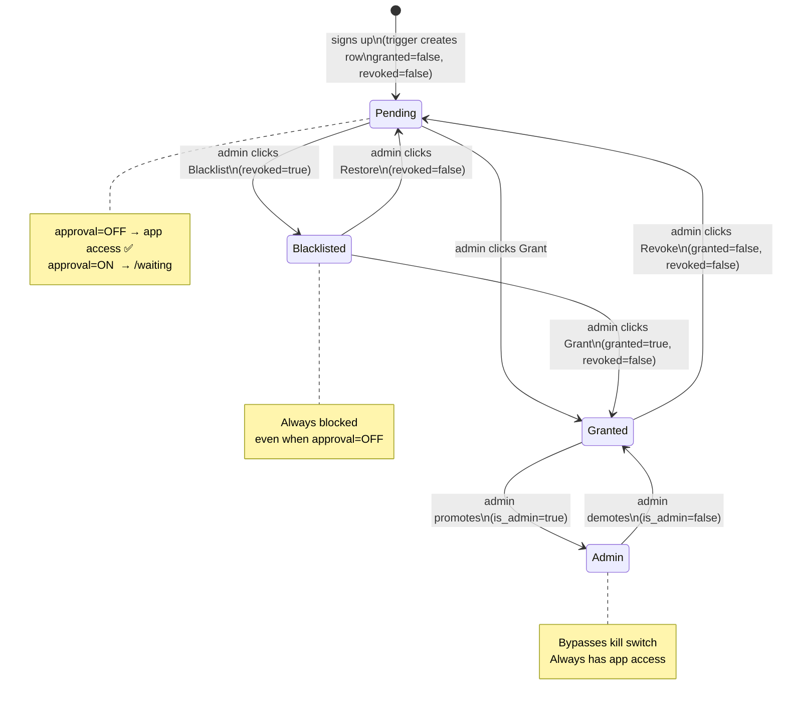

# Technical Architecture — DSA Tracker

> Last updated: October 2026

---

## Diagrams

### 1 — System Architecture



---

### 2 — Database Schema (ER)



---

### 3 — Middleware Decision Flow



---

### 4 — User Lifecycle State Machine



---

## Overview

DSA Tracker is a personal, invite-only web application for tracking LeetCode and other DSA problem-solving progress. It generates personalised daily queues, tracks streaks and history, and provides an admin panel for user access management.

---

## Stack

| Layer | Technology |
|---|---|
| Framework | Next.js 16 (App Router) |
| Language | TypeScript 5 |
| UI | React 19, Vanilla CSS |
| Database | Supabase (PostgreSQL) |
| Auth | Supabase Auth (Google OAuth + email/password) |
| Hosting | Vercel (serverless edge) |
| Math rendering | KaTeX |

**Key libraries:**
- `@supabase/supabase-js` v2 — direct DB client (service role, admin operations)
- `@supabase/ssr` v0.12 — session-aware server/browser clients for Next.js

---

## Repository Layout

```
dsa-tracker/
├── app/                    # Next.js App Router pages + API routes
│   ├── layout.tsx          # Root layout (fonts, global CSS)
│   ├── page.tsx            # Main queue page (/)
│   ├── admin/page.tsx      # Admin panel (/admin)
│   ├── analytics/page.tsx  # Analytics (/analytics)
│   ├── history/page.tsx    # Queue history (/history)
│   ├── problems/page.tsx   # Problem browser (/problems)
│   ├── settings/page.tsx   # User settings (/settings)
│   ├── login/page.tsx      # Auth page (/login)
│   ├── waiting/page.tsx    # Access pending / maintenance (/waiting)
│   ├── auth/callback/      # OAuth callback handler
│   └── api/
│       ├── queue/          # Queue generation + history
│       │   ├── route.ts    # GET (fetch today's queue), POST (regenerate)
│       │   ├── skip/       # POST (skip a problem)
│       │   └── history/    # GET (queue history with versions)
│       ├── progress/       # PATCH (update problem status)
│       ├── streak/         # GET (current streak)
│       ├── settings/       # GET + PATCH (user settings)
│       └── admin/
│           ├── users/      # GET + POST (list / pre-approve)
│           │   └── [userId]/ # PATCH + DELETE (grant/revoke/blacklist)
│           ├── stats/      # GET (per-user analytics)
│           └── settings/   # GET + PATCH (system toggles)
├── lib/
│   ├── supabase-server.ts  # Cookie-aware server client (API routes)
│   ├── supabase-browser.ts # Browser client (client components)
│   └── supabase-admin.ts   # Service-role client (admin operations)
├── middleware.ts            # Auth + access control on every request
├── components/             # Shared UI components
├── types/                  # Shared TypeScript types
├── config/                 # App configuration (topics, subtopics)
├── data/                   # Static data files
├── scripts/                # One-off scripts (data import, etc.)
└── docs/
    ├── migrations/         # All SQL migration files in order
    ├── plans/              # Feature plans (1.md … 6.1.md)
    └── reviews/            # Audits and reviews
```

---

## Database Schema

All tables live in Supabase's `public` schema backed by PostgreSQL. `auth.users` is managed by Supabase Auth.

### Core tables

#### `problems`
Seeded from LeetCode data. Read-only in production.

| Column | Type | Notes |
|---|---|---|
| `id` | integer PK | LeetCode problem ID |
| `title` | text | |
| `title_slug` | text | URL slug |
| `difficulty` | text | `Easy` / `Medium` / `Hard` |
| `topic_tags` | text[] | e.g. `['array', 'dp']` |
| `description` | text | Problem statement |
| `ac_rate` | numeric | Acceptance rate |
| `paid_only` | boolean | |
| `olt_score` | numeric | Custom difficulty score |
| `sub_type` | text | e.g. `graph`, `tree` |
| `source` | text | `leetcode` / other |
| `external_url` | text | |

#### `user_progress`
One row per user per problem. Tracks status and timing.

| Column | Type | Notes |
|---|---|---|
| `user_id` | UUID FK → auth.users | |
| `problem_id` | integer FK → problems | |
| `status` | text | `TO_DO` / `ATTEMPTING` / `SOLVED` |
| `updated_at` | timestamptz | |
| `attempt_started_at` | timestamptz | When ATTEMPTING was first set |
| `solve_duration_secs` | integer | Seconds from start to SOLVED |
| `first_attempted_at` | timestamptz | |

RLS: `ALL` — `user_id = auth.uid()`

#### `daily_queues`
One row per user per day. Stores the ordered list of problem IDs for the day.

| Column | Type | Notes |
|---|---|---|
| `user_id` | UUID FK → auth.users | |
| `date` | date | Queue date |
| `problem_ids` | integer[] | Ordered list |
| `generated_at` | timestamptz | |

RLS: `ALL` — `user_id = auth.uid()`

#### `queue_history`
Append-only log. Every regeneration creates a new row (version increments per day).

| Column | Type | Notes |
|---|---|---|
| `id` | bigserial PK | |
| `user_id` | UUID FK → auth.users | |
| `date` | date | |
| `problem_ids` | integer[] | |
| `version` | integer | Increments on regen (1, 2, 3…) |
| `generated_at` | timestamptz | |

RLS: `ALL` — `user_id = auth.uid()`

#### `user_settings`
Per-user queue configuration.

| Column | Type | Default | Notes |
|---|---|---|---|
| `user_id` | UUID PK → auth.users | | |
| `daily_count` | integer | 5 | Total problems per day (1–20) |
| `hard_count` | integer | 2 | |
| `medium_count` | integer | 3 | |
| `easy_count` | integer | 0 | |
| `difficulty_mode` | text | `standard` | `chill` / `standard` / `grind` / `custom` |
| `enabled_topic_slugs` | text[] | null | null = all topics |
| `topic_weight_overrides` | jsonb | `{}` | `{ "dp": 2.0 }` = 2× weight |
| `enabled_sources` | text[] | `['leetcode']` | |
| `cooldown_days` | integer | 7 | Days before a solved problem re-enters pool |

RLS: `ALL` — `user_id = auth.uid()`

#### `user_access`
Access control gate. One row per registered user.

| Column | Type | Default | Notes |
|---|---|---|---|
| `user_id` | UUID PK → auth.users | | |
| `granted` | boolean | false | Admin approved |
| `revoked` | boolean | false | Admin explicitly blacklisted |
| `is_admin` | boolean | false | Admin panel access |
| `email` | text | null | Cached from auth.users |
| `display_name` | text | null | Cached from OAuth metadata |
| `requested_at` | timestamptz | now() | When the row was created |
| `admin_notes` | text | null | Free-text notes by admin |

RLS: `SELECT` only — `user_id = auth.uid()` (writes via service role only)

**User lifecycle states:**

| State | `granted` | `revoked` | `is_admin` | Notes |
|---|---|---|---|---|
| Pending | false | false | false | Signed up, awaiting review |
| Granted | true | false | false | Approved |
| Revoked | false | false | false | Temporarily un-granted (back to Pending) |
| Blacklisted | any | **true** | false | Explicitly blocked |
| Admin | any | false | **true** | Always passes middleware |
| Orphaned | — | — | — | No row (trigger failure or deleted) |

**DB trigger** `on_auth_user_access_created`: fires `AFTER INSERT ON auth.users`, inserts `(user_id, granted=false, email, display_name)` with `ON CONFLICT DO NOTHING`.

#### `system_settings`
Single-row global toggles. Enforced by `CHECK (id = 1)`.

| Column | Type | Default | Notes |
|---|---|---|---|
| `id` | integer PK | 1 | Always 1 |
| `approval_required` | boolean | true | Gate for new user access |
| `site_enabled` | boolean | true | Kill switch |
| `updated_at` | timestamptz | now() | |

RLS: ON but no policies — service role key bypasses; anon key is blocked by default.

### Views

#### `problems_with_status`
Joins `problems` with the current user's `user_progress` row via `auth.uid()`. Exposes `status`, `status_updated_at`, timing columns.

Created with `security_invoker = true` — RLS is applied using the caller's identity (not the view creator's), eliminating the Supabase Security Definer warning.

---

## Authentication & Access Flow

### Signup / Login

```
Browser → /login
  ├─ Google OAuth → Supabase → /auth/callback?code=…
  │     └─ exchangeCodeForSession()
  │         ├─ Sets session cookies on redirect response
  │         └─ Upsert user_access (ignoreDuplicates=true — preserves granted=true)
  │             └─ Redirect → /
  └─ Email+password → signUp() / signInWithPassword()
        └─ Email confirmation required before session is valid
```

### Middleware (runs on every non-static request)

[`middleware.ts`](../middleware.ts) executes in the **Vercel Edge Runtime** on every request matching the config matcher (excludes `_next/static`, images, favicon).

**Execution order:**

```
1. Refresh session (supabase.auth.getUser())
2. Fetch system_settings (service role, single-row PK lookup, ~5ms)
3. /waiting smart block (logged-in users only):
     - Re-evaluate actual access state on every /waiting request
     - Redirect admins → /
     - Redirect granted/pending-with-approval-off → /
     - Fix stale ?reason= param if site came back up
4. Unauthenticated + non-public path → /login (or /waiting?reason=maintenance if site down)
5. Unauthenticated + /login + site disabled → /waiting?reason=maintenance
6. Kill switch (site_enabled=OFF) + logged-in non-admin → /waiting?reason=maintenance
7. Whitelist check (approval_required=ON):
     - Fetch user_access (granted, is_admin)
     - Not granted → /waiting
     - /admin path: re-verify is_admin via service role
8. Whitelist check (approval_required=OFF):
     - Fetch user_access (granted, is_admin, revoked)
     - revoked=true → /waiting (blacklisted, always blocked)
     - /admin path: re-verify is_admin via service role
```

**Public paths** (always pass through): `/login`, `/auth/callback`, `/waiting`

**Safe fallback**: any DB error in `getSystemSettings()` returns `{ approval_required: true, site_enabled: true }` — most restrictive, never accidentally opens.

---

## API Routes

All routes are **Next.js Route Handlers** (server-side, Node.js runtime, not Edge).

Every route authenticates via `supabase.auth.getUser()` as first step. `user_id` is always taken from the server-verified JWT — never from the request body.

### Queue

| Method | Route | Description |
|---|---|---|
| `GET` | `/api/queue` | Fetch today's queue (generates if missing) |
| `POST` | `/api/queue` | Regenerate today's queue |
| `POST` | `/api/queue/skip` | Skip a problem, get replacement |
| `GET` | `/api/queue/history` | Queue history, grouped by date + version |

**Queue generation algorithm** (`app/api/queue/route.ts`):
1. Load `user_settings` (daily_count, difficulty split, topic filters, cooldown_days, sources)
2. Fetch all problems matching source/topic filters
3. Exclude problems solved within `cooldown_days`
4. Weight by `topic_weight_overrides` and `olt_score`
5. Pick problems matching the difficulty split (hard/medium/easy counts)
6. Write to `daily_queues`, append to `queue_history` (version++)

### Progress

| Method | Route | Description |
|---|---|---|
| `PATCH` | `/api/progress` | Update a problem's status (TO_DO / ATTEMPTING / SOLVED) |

### Streak

| Method | Route | Description |
|---|---|---|
| `GET` | `/api/streak` | Returns current streak (consecutive days with ≥1 SOLVED) |

### Settings

| Method | Route | Description |
|---|---|---|
| `GET` | `/api/settings` | Fetch user settings |
| `PATCH` | `/api/settings` | Update user settings |

### Admin (all require `is_admin=true`)

| Method | Route | Description |
|---|---|---|
| `GET` | `/api/admin/users` | List all users (with access rows + auth enrichment) |
| `POST` | `/api/admin/users` | Pre-grant by email |
| `PATCH` | `/api/admin/users/[userId]` | Grant / revoke / promote / notes |
| `DELETE` | `/api/admin/users/[userId]` | Blacklist (sets `revoked=true`, keeps row) |
| `GET` | `/api/admin/stats` | Per-user analytics (solved count, topics, last active) |
| `GET` | `/api/admin/settings` | Fetch system toggles |
| `PATCH` | `/api/admin/settings` | Update system toggles |

**Admin auth helper** (`getAdminUser()`): reads session cookie → `getUser()` → fetches `user_access.is_admin` via service role client → returns user or null.

---

## Supabase Clients

Three distinct client configurations, each used in the right context:

| Client | File | Key used | Context |
|---|---|---|---|
| Server (session-aware) | `lib/supabase-server.ts` | `NEXT_PUBLIC_SUPABASE_ANON_KEY` | API routes, server components — respects RLS via user session |
| Browser | `lib/supabase-browser.ts` | `NEXT_PUBLIC_SUPABASE_ANON_KEY` | Client components (`'use client'`) |
| Admin (service role) | `lib/supabase-admin.ts` | `SUPABASE_SERVICE_ROLE_KEY` | Admin API routes, middleware — bypasses RLS |

> [!CAUTION]
> `SUPABASE_SERVICE_ROLE_KEY` has no `NEXT_PUBLIC_` prefix — Next.js never bundles it into client-side JavaScript. It is used exclusively in server-side code.

---

## Pages

| Route | Auth required | Notes |
|---|---|---|
| `/` | ✅ Granted | Main queue view, streak, progress controls |
| `/problems` | ✅ Granted | Full problem browser with filters |
| `/analytics` | ✅ Granted | Personal stats (topics, difficulty split) |
| `/history` | ✅ Granted | Queue history by date, expandable versions |
| `/settings` | ✅ Granted | Queue config (count, difficulty, topics, sources) |
| `/admin` | ✅ is_admin | User management + system toggles + analytics |
| `/login` | Public* | Google OAuth + email/password |
| `/waiting` | Public | Access pending OR maintenance (based on `?reason=`) |
| `/auth/callback` | Public | OAuth code exchange — always must be accessible |

*`/login` redirects to `/waiting?reason=maintenance` when `site_enabled=OFF`.

### `/waiting` page behaviour

Reads session on mount (`supabase.auth.getSession()`). Renders differently based on:

| `?reason=` | `isLoggedIn` | Shows |
|---|---|---|
| *(absent)* | true | "Access Pending" + Sign Out |
| `maintenance` | true | "Down for Maintenance" + Sign Out |
| `maintenance` | false | "Down for Maintenance" (no sign out, no admin hint) |

---

## Access Control Matrix

When `approval_required=ON`:

| User state | `/` and app | `/admin` | `/waiting` |
|---|---|---|---|
| Unauthenticated | → /login | → /login | ✅ (public) |
| Pending | → /waiting | → /waiting | ✅ |
| Blacklisted | → /waiting | → /waiting | ✅ |
| Granted | ✅ | → / | ✅ (redirected to /) |
| Admin | ✅ | ✅ | ✅ (redirected to /) |

When `approval_required=OFF`:

| User state | `/` and app | Notes |
|---|---|---|
| Pending / Orphaned | ✅ | Never explicitly blocked |
| Blacklisted (`revoked=true`) | → /waiting | Always blocked regardless of toggle |
| Granted / Admin | ✅ | |

When `site_enabled=OFF` (kill switch):

| User state | Result |
|---|---|
| Unauthenticated | → /waiting?reason=maintenance |
| Unauthenticated + /login | → /waiting?reason=maintenance |
| Non-admin | → /waiting?reason=maintenance |
| Admin | ✅ Passes through |

---

## Deployment

- **Hosting**: Vercel (auto-deploy on push to `main`)
- **Environment variables**: set in Vercel project settings
  - `NEXT_PUBLIC_SUPABASE_URL`
  - `NEXT_PUBLIC_SUPABASE_ANON_KEY`
  - `SUPABASE_SERVICE_ROLE_KEY`
- **DB migrations**: run manually in Supabase SQL Editor (see `docs/migrations/` in chronological order)
- **Middleware runtime**: Vercel Edge (runs globally at CDN nodes)
- **API routes runtime**: Node.js serverless functions

### Migration history (in order)

| File | What it does |
|---|---|
| `phase2.sql` | `user_progress` timing cols, `user_settings`, view rebuild |
| `phase4.sql` | `queue_history`, `user_access`, `problems` sub_type/source cols |
| `phase4e.sql` | Extended problem schema |
| `phase4f.sql` | Minor schema fix |
| `admin_panel.sql` | `user_access` email/display_name cols, updated trigger |
| `fix_new_user_trigger.sql` | Rebuild trigger with exception guard |
| `subtopics_config.sql` | Subtopics config table |
| `system_settings.sql` | Global toggles table (Plan 5) |
| `plan6_fixes.sql` | Backfill null email/display_name; recreate view with security_invoker |
| `plan6.1_display_name.sql` | Fix display_name rows incorrectly set to email |
| `plan6.2_revoked_column.sql` | Add `revoked` boolean to `user_access` |

---

## Security Model

| Concern | Mitigation |
|---|---|
| Unauthenticated API access | Every route calls `getUser()` → 401 if no session |
| Cross-user data reads | All queries scoped to `user.id` (server-verified JWT), RLS as defense-in-depth |
| Admin privilege escalation | `user_access` has SELECT-only RLS for regular users; is_admin checked via service role |
| Service role key exposure | No `NEXT_PUBLIC_` prefix; never in browser bundle |
| Bot account creation | Email confirmations required (Supabase setting, verified ON) |
| OAuth redirect hijack | `redirectTo` built from `window.location.origin`, validated by Supabase allow-list |
| `/waiting` dead-end stale state | Middleware re-evaluates every logged-in `/waiting` request and redirects correctly |

Full audit: [`docs/reviews/public_sharing_audit.md`](reviews/public_sharing_audit.md) — all checks passed Oct 13, 2026.
